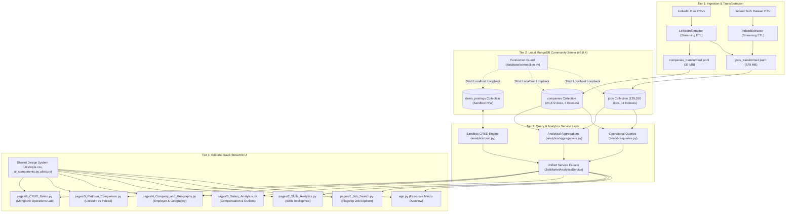
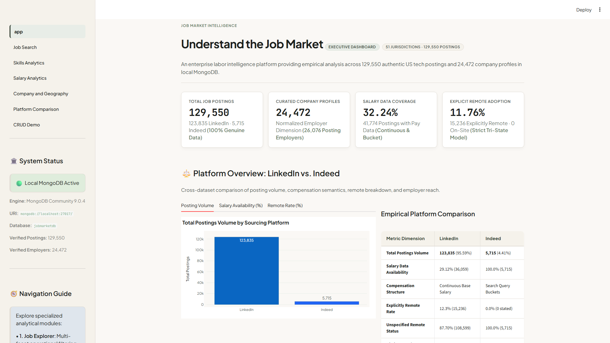
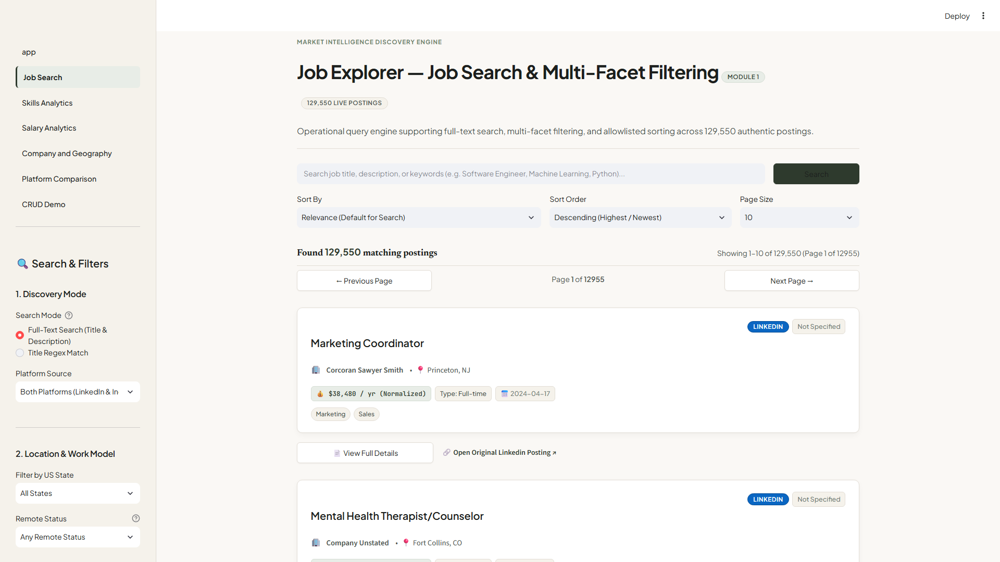
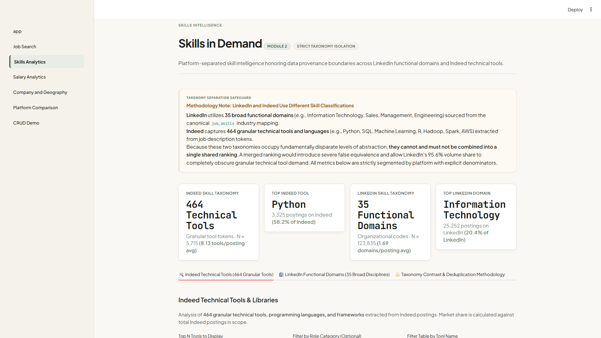
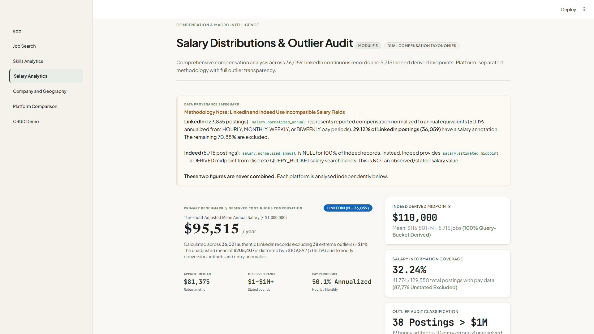
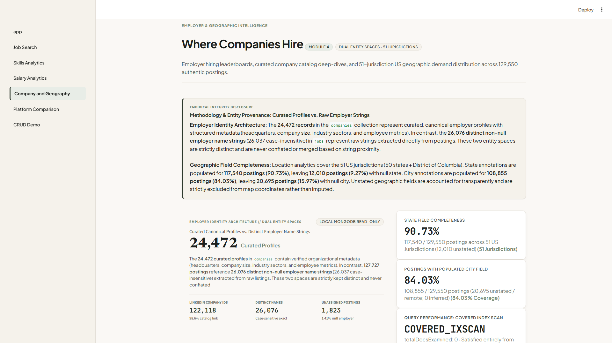
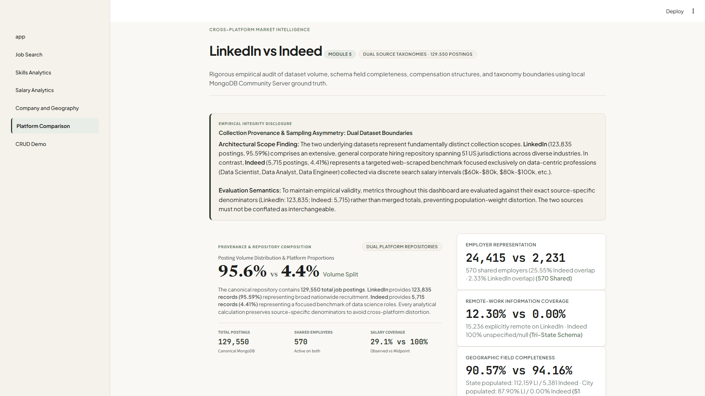
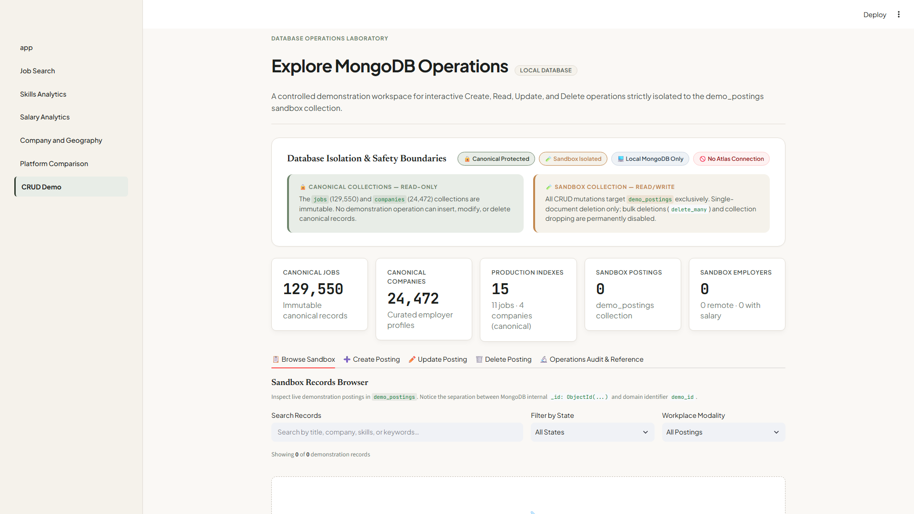
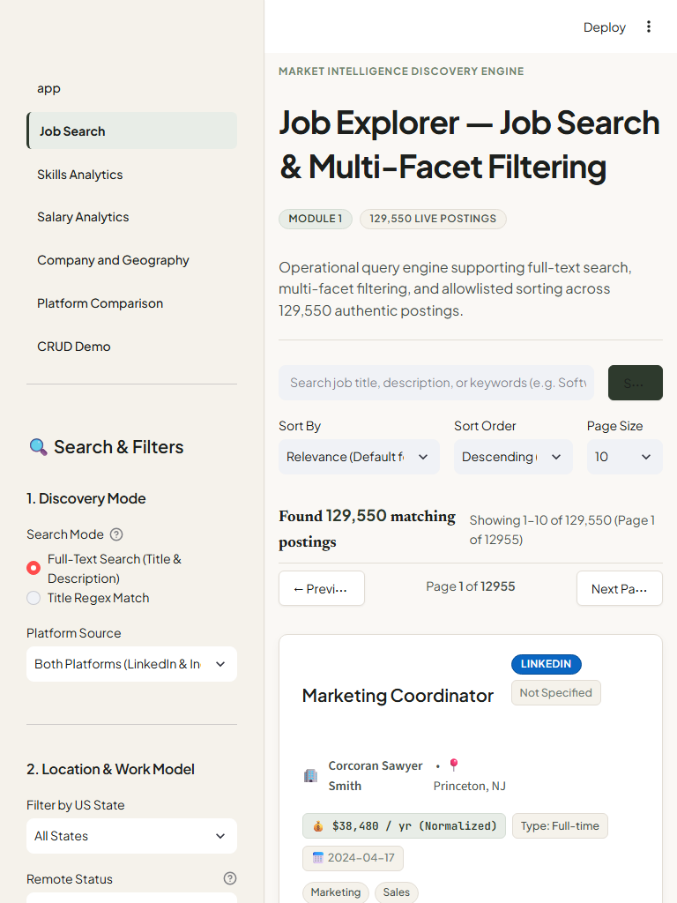
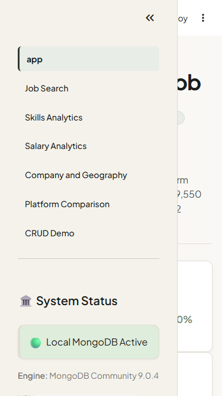

# JobMarketDB — Enterprise Tech Labor Intelligence & Job Discovery Platform

[](https://www.mongodb.com/)
[](https://www.python.org/)
[](https://streamlit.io/)
[](https://plotly.com/)
[]()

**JobMarketDB** is an enterprise-grade labor market intelligence and job discovery system engineered on a document-oriented **MongoDB** database and an editorial **Streamlit** application interface. 

The platform aggregates, cleanses, enriches, and analyzes **129,550 authentic US tech job postings** and **24,472 curated company profiles** across two leading data sources (**LinkedIn** and **Indeed**), maintaining strict data provenance, taxonomical isolation, and compensation methodology separation.

---

## 1. Project Title & Overview

- **Project Name:** JobMarketDB (MongoDB-Based Job Search and Job Market Analytics System)
- **Deployment Model:** **Strictly Localhost Standalone** (`mongodb://localhost:27017/jobmarketdb`)
- **Visual Identity:** **Premium Sage & Ivory Commercial SaaS Design System**
- **Core Repository:** Unified ETL pipeline, query/aggregation service layer, multi-page Streamlit application, automated regression test batteries, and browser verification automation.

---

## 2. Problem Statement

Modern online recruitment datasets suffer from widespread inconsistencies:
- **Taxonomy Mismatches:** Platforms classify candidate skills at divergent levels of abstraction (e.g., broad occupational domains vs. granular libraries). Naively aggregating them creates misleading rankings.
- **Compensation Incompatibility:** Mixing continuous base salaries with query search intervals yields inaccurate market statistics.
- **Data Quality & Scraping Artifacts:** Unaudited records contain hourly-to-annual calculation errors (e.g., compensation exceeding $1M) and upstream missing attributes (e.g., omitted city or remote indicators).
- **Relational Scale Bottlenecks:** Joining millions of tabular records across postings, company metadata, and skill junctions degrades performance without document-oriented embedding and indexing.

JobMarketDB resolves these challenges by using a hybrid document-oriented architecture in local MongoDB that guarantees sub-second analytics while preserving data provenance.

---

## 3. Objectives & Scope

```
+-------------------------------------------------------------------------------------------------+
|                                 JobMarketDB Core System Objectives                              |
+-------------------------------------------------------------------------------------------------+
|  1. Document Modeling     | Schema design leveraging MongoDB embedding & references.           |
|  2. High-Performance ETL  | Streaming pipeline processing 129,550 postings without memory bloat.|
|  3. Analytical Engine     | 12 public service operations delivering sub-second aggregations.   |
|  4. Strict Data Safety    | Canonical collections (jobs, companies) are 100% immutable.        |
|  5. Editorial SaaS UI     | Premium Sage & Ivory interface across 7 interconnected modules.    |
|  6. Educational Sandbox   | Safe CRUD laboratory isolating writes to disposable collections.   |
+-------------------------------------------------------------------------------------------------+
```

### Scope:
- **Full-Text & Multi-Facet Discovery:** Search across title, company, and description with allowlisted sorting, experience filtering, state filtering, and `ALL`/`ANY` skill matching.
- **Skills Taxonomy Separation:** Independent ranking of 464 technical tools (Indeed) and 35 functional domains (LinkedIn).
- **Salary Reconciliation & Outlier Audits:** Empirical separation between LinkedIn continuous pay and Indeed search midpoints.
- **Geographic Choropleth:** 51-jurisdiction US map of tech hiring distribution across all 50 states + Washington D.C.
- **Safe CRUD Sandbox:** Controlled Create, Read, Update, and Delete operations restricted to disposable collections.

---

## 4. Features & Application Pages

The application is structured into seven specialized modules:

| # | Page Module | File Path | Key Capabilities |
| :- | :--- | :--- | :--- |
| **0** | **Home Dashboard** | [`app.py`](app.py) | Executive macro metrics (`129,550` jobs, `24,472` companies), platform volume split, architecture overview, and market intelligence callouts. |
| **1** | **Job Explorer** | [`pages/1_Job_Search.py`](pages/1_Job_Search.py) | Search query engine with text/regex search, facet filters (source, remote, state, experience, salary), `ALL`/`ANY` skill matching, and same-platform related job recommendations. |
| **2** | **Skills Analytics** | [`pages/2_Skills_Analytics.py`](pages/2_Skills_Analytics.py) | Dual-taxonomy skills intelligence: Indeed technical tools (Python, SQL, AWS) vs. LinkedIn functional disciplines (Information Technology, Management), with role category denominator normalization. |
| **3** | **Salary Analytics** | [`pages/3_Salary_Analytics.py`](pages/3_Salary_Analytics.py) | Comprehensive compensation intelligence: LinkedIn continuous pay ($95,515 adjusted mean, $81,375 median) vs. Indeed search midpoints ($116,501.31 mean, $110,000 median) with 38-outlier transparent audit. |
| **4** | **Company & Geography** | [`pages/4_Company_and_Geography.py`](pages/4_Company_and_Geography.py) | Employer leaderboard, curated company profile deep-dives across 24,472 employers, and 51-jurisdiction US choropleth hiring density map. |
| **5** | **Platform Comparison** | [`pages/5_Platform_Comparison.py`](pages/5_Platform_Comparison.py) | Side-by-side empirical audit: 14-field schema completeness matrix, 570 shared employers analysis, remote tri-state semantics, and standardized 6-tier salary bucket comparison. |
| **6** | **CRUD Demo** | [`pages/6_CRUD_Demo.py`](pages/6_CRUD_Demo.py) | Educational database laboratory: isolated Create/Read/Update/Delete operations targeting `demo_postings`, salary removal via atomic `$unset`, single-document deletion guards, and session audit logs. |

---

## 5. Technology Stack

- **Runtime Environment:** Python 3.13+
- **Database Engine:** MongoDB Community Server v9.0.4 (Local Standalone on Port 27017)
- **Database Driver:** PyMongo 4.19.0
- **Web Application Framework:** Streamlit 1.66.1
- **Data Manipulation & Analytics:** Pandas 3.1.0, NumPy
- **Data Visualization:** Plotly 7.1.0
- **Configuration Management:** python-dotenv 1.2.4
- **Testing & Verification:** Python `unittest`, Playwright 1.64.1 (Chromium / Google Chrome)

---

## 6. System Architecture



For comprehensive architectural specifications, refer to [PROJECT_ARCHITECTURE.md](docs/PROJECT_ARCHITECTURE.md).

---

## 7. Dataset Overview & Provenance

JobMarketDB ingests data from two distinct upstream repositories:
1. **LinkedIn Job Postings (2023–2024):** Relational tables (`postings.csv`, `companies.csv`, `job_skills.csv`, `skills_mapping.csv`) capturing 123,835 tech postings, continuous annualized salaries, and company dimensions.
2. **Indeed Tech Dataset:** Granular postings across data science and software engineering categories capturing 5,715 postings, technical programming libraries, and search-band midpoints.

---

## 8. Data Preparation & Transformation Methodology

The streaming ETL pipeline ([`scripts/run_etl.py`](scripts/run_etl.py)) extracts, cleanses, enriches, and serializes records into newline-delimited JSON (`.jsonl`) files:
- **Streaming Extraction:** Prevents memory exhaustion by processing records sequentially.
- **Idempotent Ingestion:** Enforces unique compound constraints on `(source, source_job_id)` and `company_id`.
- **Referential Integrity:** Preserves the authentic relationship of posting `3708903045` referencing unlisted company `23729571` with `company.name: null` without fabricating data.

For in-depth ETL documentation, refer to [DATA_METHODOLOGY.md](docs/DATA_METHODOLOGY.md).

---

## 9. MongoDB Database & Collection Design

- **`jobmarketdb.jobs` (129,550 documents):** Canonical postings collection. Contains embedded employer names, geographic attributes, compensation models, and multikey skill arrays.
- **`jobmarketdb.companies` (24,472 documents):** Curated employer dimension collection.
- **`jobmarketdb.demo_postings` (0 documents baseline):** Disposable collection for interactive CRUD testing.

Detailed collection schemas and data types are available in [DATABASE_DESIGN.md](docs/DATABASE_DESIGN.md) and [DATA_DICTIONARY.md](docs/DATA_DICTIONARY.md).

---

## 10. Indexing Strategy (15 Production Indexes)

JobMarketDB implements **15 query-driven indexes** ensuring that queries leverage `IXSCAN` or `COVERED_IXSCAN` execution:

### Indexes on `jobs` (11 Indexes):
1. `_id_`: Default unique primary key.
2. `source_1_source_job_id_1_unique`: Unique index guaranteeing source idempotency.
3. `source_1_posting_date_-1`: Chronological feeds filtered by platform.
4. `company.name_1`: Employer name lookups and leaderboard queries.
5. `location.state_1_location.city_1`: Geographic hierarchy filtering.
6. `location.state_1_location.is_remote_1`: Covered index for modality and state.
7. `experience_level_1`: Seniority level queries.
8. `skills_1`: Multikey array index for `ALL`/`ANY` skill matching.
9. `salary.normalized_annual_1`: Continuous salary range filtering.
10. `salary.estimated_midpoint_1`: Indeed search midpoint filtering.
11. `title_text_description_text`: Full-text linguistic index on job titles and descriptions.

### Indexes on `companies` (4 Indexes):
1. `_id_`: Default unique primary key.
2. `company_id_1_unique`: Unique relational foreign key index.
3. `name_1`: Alphabetical employer search.
4. `state_1_city_1`: Employer headquarters geographic filtering.

---

## 11. Query & Aggregation Service Implementation

The service layer exports 12 primary operations through [`analytics/service.py`](analytics/service.py):
- **Operations 1–7 (Operational Queries):** Title keyword search, geographic modality filters, salary range filters, skill matching (`ALL`/`ANY`), employer search, experience level search, composite multi-facet filtering.
- **Operations 8–12 (Analytical Pipelines):** Top demanded skills, employer hiring leaderboards, 6-tier salary bucket distributions, cross-platform market overview, and 14-field schema completeness audits.

---

## 12. CRUD Demonstration & Sandbox Safety

The **CRUD Operations Laboratory** ([`pages/6_CRUD_Demo.py`](pages/6_CRUD_Demo.py)) demonstrates MongoDB document lifecycle operations with fail-safe boundaries:
- **Canonical Immutability:** Write commands to `jobs` or `companies` are blocked by target-collection isolation.
- **Sandbox Isolation:** All mutations execute exclusively against `jobmarketdb.demo_postings`.
- **Atomic Operations:** Demonstrates `$set` field updates and `$unset` field removals (e.g. removing salary subdocuments).
- **Single-Document Deletion Guard:** Enforces `deleteOne()` exclusively with confirmation checkbox verification. Bulk deletion (`delete_many`) and collection drop (`drop`) are prohibited across the application.

---

## 13. Installation Prerequisites

- **Operating System:** Windows, macOS, or Linux.
- **Python:** Version 3.13+ recommended.
- **Database:** Local MongoDB Community Server v9.0.4+ installed and running as a local service on port 27017.
- **Memory & Disk:** Minimum 8 GB RAM; ~3 GB free disk space for MongoDB data storage.

---

## 14. Local MongoDB Setup

1. Install MongoDB Community Server from [mongodb.com](https://www.mongodb.com/try/download/community).
2. Ensure MongoDB is running locally on port 27017:
   ```bash
   # Windows PowerShell
   Get-Service MongoDB
   
   # Linux / macOS
   sudo systemctl status mongod
   ```

---

## 15. Environment Configuration

Copy the template configuration file:
```bash
cp .env.example .env
```

Ensure `.env` contains the required local connection parameters:
```env
# JobMarketDB MongoDB Configuration (Local MongoDB Community Server Only)
MONGODB_URI=mongodb://localhost:27017/
MONGODB_DATABASE=jobmarketdb
```

> [!CAUTION]
> JobMarketDB strictly prohibits remote hosts, cloud IP addresses, and MongoDB Atlas (`mongodb+srv://`). The application enforces loopback connections (`localhost:27017` or `127.0.0.1:27017`) and will abort startup if an external endpoint is configured.

---

## 16. Dependency Installation

Create and activate a virtual environment, then install pinned dependencies:

```bash
# Create virtual environment
python -m venv venv

# Activate virtual environment
# Windows PowerShell:
.\venv\Scripts\Activate.ps1
# Linux / macOS:
source venv/bin/activate

# Install dependencies
pip install -r requirements.txt
```

---

## 17. Data ETL & MongoDB Ingestion Instructions

To populate local MongoDB from source CSV datasets:

```bash
# 1. Run streaming ETL pipeline (generates JSONL files in data/processed/)
python scripts/run_etl.py

# 2. Ingest JSONL records and build production indexes in local MongoDB
python scripts/import_to_mongodb.py
```

Upon completion, verify that collection counts match authoritative benchmarks:
- `jobs`: Exactly `129,550` documents
- `companies`: Exactly `24,472` documents
- Total Production Indexes: Exactly `15` indexes

---

## 18. How to Launch the Streamlit Application Locally

Start the Streamlit application:
```bash
streamlit run app.py --server.port 8501
```

Access the application in your browser:
- **Local Application Root:** [http://localhost:8501](http://localhost:8501)
- **Direct Page URLs:**
  - [Home Dashboard](http://localhost:8501/)
  - [Job Explorer](http://localhost:8501/Job_Search)
  - [Skills Analytics](http://localhost:8501/Skills_Analytics)
  - [Salary Analytics](http://localhost:8501/Salary_Analytics)
  - [Company & Geography](http://localhost:8501/Company_and_Geography)
  - [Platform Comparison](http://localhost:8501/Platform_Comparison)
  - [CRUD Demo](http://localhost:8501/CRUD_Demo)

---

## 19. How to Run Verification & Test Scripts

Execute the comprehensive 187-test regression battery across all analytical pipelines and UI modules:

```bash
python -m unittest scripts.test_phase_6_step_4 scripts.test_phase_6_step_7 scripts.test_phase_6_step_9 scripts.test_phase_7_stage_1 scripts.test_phase_7_stage_2 scripts.test_phase_7_stage_3 scripts.test_phase_7_stage_4 scripts.test_phase_7_stage_5 scripts.test_phase_7_stage_6 scripts.test_phase_7_stage_7 scripts.test_phase_7_stage_8 scripts.test_phase_7_stage_9
```

To run real-browser automation with headless Google Chrome:
```bash
python scripts/verify_phase_7_stage_9_browser.py
```

Detailed test logs and verification specifications are documented in [TESTING_AND_VERIFICATION.md](docs/TESTING_AND_VERIFICATION.md).

---

## 20. Known Limitations & Future Improvements

1. **Upstream Scraper Data Gaps:**
   - Indeed `location.city` is 100% null (accommodated via state-level choropleth aggregations).
   - Indeed `location.is_remote` is 100% null (handled via explicit tri-state semantics).
2. **Storage Scale on Atlas Free Tier:**
   - The unified BSON dataset (~680 MB) exceeds the MongoDB Atlas M0 free tier limit (512 MB). The application is intentionally configured for local MongoDB Community Server.
3. **Future Planned Enhancements:**
   - Vector search integration for semantic job title embeddings.
   - LLM-assisted resume-to-posting skill gap scoring.
   - Live scraper ingestion microservices with change streams.

---

## Visual Gallery

````carousel

<!-- slide -->

<!-- slide -->

<!-- slide -->

<!-- slide -->

<!-- slide -->

<!-- slide -->

<!-- slide -->

<!-- slide -->

````

---

## Project Documentation Index

- [PROJECT_OVERVIEW.md](docs/PROJECT_OVERVIEW.md) — Executive summary, problem statement, and scope boundaries.
- [PROJECT_ARCHITECTURE.md](docs/PROJECT_ARCHITECTURE.md) — 4-tier structural architecture, data flow, and caching strategy.
- [DATABASE_DESIGN.md](docs/DATABASE_DESIGN.md) — Document modeling, collection schemas, and 15-index strategy.
- [DATA_DICTIONARY.md](docs/DATA_DICTIONARY.md) — Field-by-field BSON specifications and nullability rules.
- [DATA_METHODOLOGY.md](docs/DATA_METHODOLOGY.md) — ETL pipelines, salary reconciliation, and taxonomy separation.
- [TESTING_AND_VERIFICATION.md](docs/TESTING_AND_VERIFICATION.md) — 187-test battery and Playwright browser verification results.
