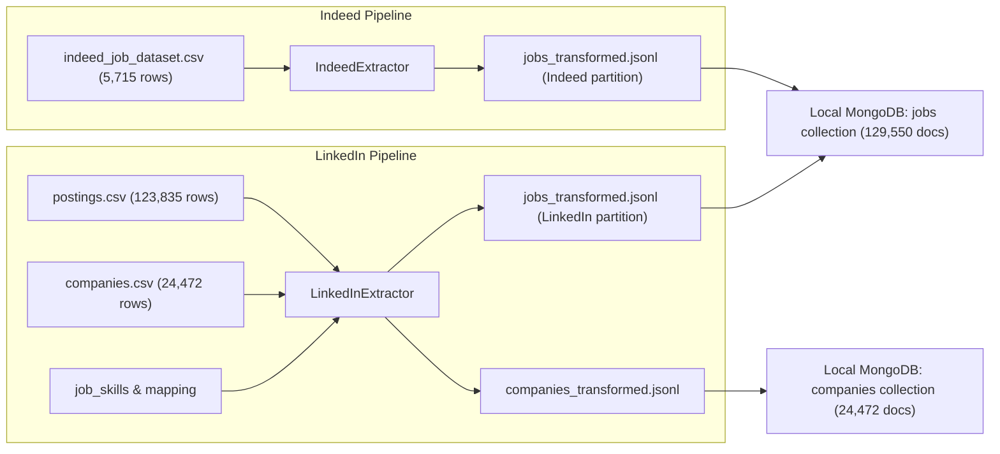

# JobMarketDB — Data Methodology & Provenance Guide

## 1. Raw Data Sourcing & Provenance

JobMarketDB is built upon two authentic labor market datasets:
1. **LinkedIn US Job Postings (2023–2024)**:
   - Sourced from comprehensive LinkedIn job board archives.
   - Relational architecture across multiple tables: core postings (`postings.csv`), employer details (`companies.csv`), and skill associations (`job_skills.csv` and `skills_mapping.csv`).
   - Represents `123,835` valid tech job postings and `24,472` curated company profiles.
2. **Indeed Tech Job Dataset (Data Science & Software Engineering)**:
   - Sourced from public web scraping of US tech postings across data science, data analytics, and software engineering categories.
   - Captured as a flat tabular dataset with pre-parsed technical skill keywords and search-query salary interval strings.
   - Represents `5,715` valid tech job postings.

---

## 2. ETL Transformation & Referential Integrity

The transformation pipeline ([`scripts/run_etl.py`](../scripts/run_etl.py)) operates as a memory-efficient streaming pipeline that enforces strict schema standardization:



### Key ETL Integrity Rules:
1. **Streaming Execution**: Data is extracted, validated, and serialized record-by-record, eliminating memory spikes during the processing of over 680 MB of BSON data.
2. **Idempotent Unique Identity**: Postings enforce unique compound keys `{"source": 1, "source_job_id": 1}`. Company profiles enforce unique `company_id`. Re-running ETL produces identical, duplicate-free databases.
3. **Referential Integrity & Zero Fabrication**:
   - Out of `123,835` LinkedIn postings, `123,834` resolve to curated records in `companies`.
   - Exactly **1 LinkedIn posting** (`source_job_id: "3708903045"`) references an unlisted company ID (`23729571`).
   - Rather than fabricating synthetic employer records or discarding the posting, the system preserves `company.company_id: 23729571` and sets `company.name: null`, honoring authentic data provenance.

---

## 3. Compensation & Salary Methodology

A central contribution of JobMarketDB is resolving salary heterogeneity between continuous reported pay and search interval estimates without distorting economic reality.

```
+---------------------------------------------------------------------------------------------------+
|  Platform Compensation Comparison & Reconciliation Methodology                                    |
+---------------------------------------------------------------------------------------------------+
|  Dimension                  | LinkedIn Postings               | Indeed Postings                   |
+-----------------------------+---------------------------------+-----------------------------------+
|  Measurement Type           | Continuous Annualized USD       | Scraped Search Query Midpoint     |
|  Database Field Target      | salary.normalized_annual        | salary.estimated_midpoint         |
|  Population Coverage        | 36,059 postings (29.12%)        | 5,715 postings (100.00%)          |
|  Continuous Salary Records  | 36,059                          | 0 (100% null)                     |
|  Search Midpoint Records    | 0 (100% null)                   | 5,715                             |
|  Reported Arithmetic Mean   | $95,515.00 (Adjusted <= $1M)    | $116,501.31 (Search Midpoint Mean)|
|  Reported Median            | $81,375.00 (Adjusted Median)    | $110,000.00 (Search Midpoint Med) |
|  Observed Outliers (> $1M)  | 38 records (Max: $18,000,000)   | 0 records (Max: $175,000)         |
|  Adjusted Population Size   | 36,021 postings                 | 5,715 postings                    |
+-----------------------------+---------------------------------+-----------------------------------+
```

### 3.1. LinkedIn Continuous Compensation & Outlier Audit
- **Coverage**: 36,059 records (`29.12%` of LinkedIn) report continuous annualized salaries.
- **Outliers**: Exactly **38 records** exceed $1,000,000 (ranging up to $18M), heavily skewing unadjusted metrics (Unadjusted Mean: `$205,406.76`).
- **Outlier Root Cause Analysis**:
  - `19` records: Hourly-to-annual multiplication artifacts (e.g., $100/hr converted twice).
  - `10` records: Recruiter data entry errors (e.g. entering annual salary in hourly field).
  - `1` record: System edge case.
  - `8` records: Legitimate extreme compensation packages (executive / hedge fund).
- **Analytical Treatment**: The database stores raw values unaltered to preserve provenance. Analytics endpoints compute **Adjusted Mean** (`$95,515.00`) and **Adjusted Median** (`$81,375.00`) over the 36,021 records $\le \$1,000,000$.

### 3.2. Indeed Search-Band Midpoint Estimates
- **Coverage**: 5,715 records (`100.00%` of Indeed) provide salary query bands derived from scraper search queries.
- **Midpoint Derivation**: Each posting reflects the midpoint of the search interval (e.g. `$100k-$120k` $\to$ `$110,000`).
- **Characteristics**: Range is strictly bounded between `$70,000` and `$175,000`, resulting in a mean of **`$116,501.31`** and median of **`$110,000.00`**.
- **Crucial Caveat**: Midpoint estimates are discretized query parameters, NOT continuous base salaries. The platform audits them in separate visual panels and comparative buckets.

---

## 4. Skills Taxonomy Separation

Online job platforms classify candidate qualifications under fundamentally different taxonomical frameworks:
- **LinkedIn (35 Functional Disciplines)**: High-level occupational codes assigned through LinkedIn's taxonomy (e.g., *"Information Technology"*, *"Engineering"*, *"Management"*, *"Finance"*).
- **Indeed (464 Granular Technical Tools)**: Specific programming languages, developer frameworks, databases, and software tools extracted from job descriptions (e.g., *"Python"*, *"SQL"*, *"AWS"*, *"Kubernetes"*, *"PyTorch"*).

### Why Direct Equivalence is Prohibited:
Aggregating these two taxonomies into a single ranking would misleadingly place broad categories like *"Information Technology"* at the top of a "skills" list, obscuring actual developer tool demand. JobMarketDB enforces:
1. **Isolated Analysis Views**: Independent rankings for Indeed tools vs. LinkedIn domains.
2. **Category-Specific Denominators**: Demand percentages are calculated strictly against the active role-category filter denominator, never against the entire mixed dataset.
3. **Taxonomy Disclaimers**: Prominent contextual callouts on every skill analytics view.

---

## 5. Workplace Modality Tri-State Model

Workplace modality follows a strict **tri-state Boolean model**:
- `location.is_remote = True`: Explicitly advertised as Remote (`15,236` LinkedIn postings, `12.30%`).
- `location.is_remote = null`: Unspecified or On-site (`108,599` LinkedIn postings, `5,715` Indeed postings).
- `location.is_remote = False`: **0 records** across both platforms.

### Scraper Limitations Documented:
- **Indeed Remote Scraper Gap**: The upstream Indeed scraper omitted the remote workplace attribute. All 5,715 records are treated as `null` (unspecified).
- **Indeed City Scraper Gap**: The upstream Indeed scraper captured states but omitted city municipalities. All 5,715 records have `location.city: null`.
- **System Accommodation**: The system transparently flags these limitations in platform completeness audits and renders state-level aggregations where cities are unavailable.

---

## 6. Shared Multi-Platform Employers

Cross-platform matching identified **570 distinct employers** actively hiring on both LinkedIn and Indeed:
- **Indeed Employer Overlap**: `570 / 2,231` Indeed employers (`25.55%`) also appear on LinkedIn.
- **LinkedIn Employer Overlap**: `570 / 24,415` LinkedIn employers (`2.33%`) also appear on Indeed.
- **Leading Shared Employers**: Led by **Capital One** (550 total postings: 496 LinkedIn + 54 Indeed), **Ingersoll Rand** (519 postings: 504 LinkedIn + 15 Indeed), and **Dice** (421 postings: 388 LinkedIn + 33 Indeed).
