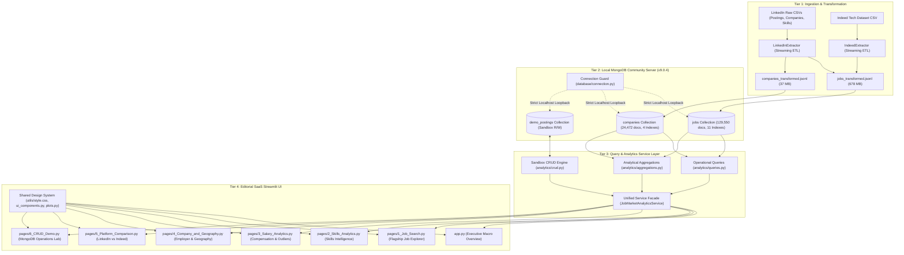
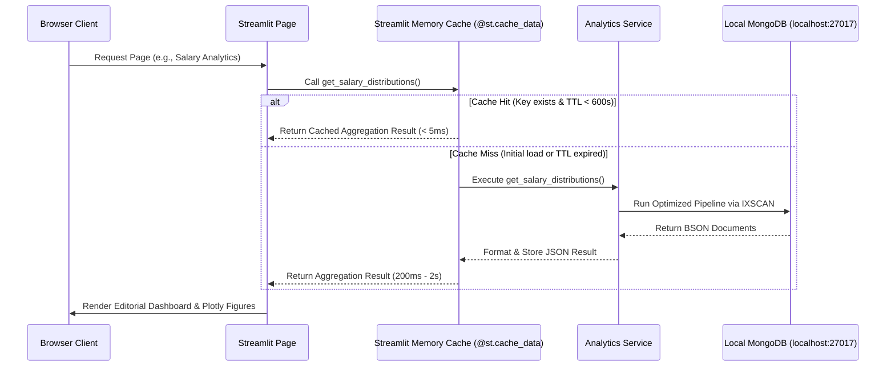

# JobMarketDB — System Architecture & Component Design

## 1. Architectural Overview
JobMarketDB follows a clean, decoupled 4-tier architecture designed for high-throughput analytical query processing, strict database safety, and modular maintainability.

---

## 2. Multi-Tier Decomposition

### Tier 1: Data Sourcing & ETL Pipeline
- **Modules**: [`ingestion/linkedin.py`](../ingestion/linkedin.py), [`ingestion/indeed.py`](../ingestion/indeed.py), [`ingestion/transformers.py`](../ingestion/transformers.py), [`ingestion/validators.py`](../ingestion/validators.py), [`scripts/run_etl.py`](../scripts/run_etl.py).
- **Functionality**:
  - Streams source CSV records chunk-by-chunk to prevent out-of-memory errors on large tabular datasets.
  - Normalizes location, employer names, salary intervals, and skill arrays.
  - Emits pre-validated, newline-delimited JSON (`.jsonl`) files ready for MongoDB bulk insertion.
  - Enforces schema validation against Phase 2 formal data models before writing output records.

### Tier 2: Local Database Engine & Connection Guards
- **Modules**: [`database/connection.py`](../database/connection.py).
- **Functionality**:
  - **Local Loopback Enforcement**: Strictly restricts connections to `localhost:27017` or `127.0.0.1:27017`.
  - **Prohibited Endpoints**: Actively parses URIs in-memory to block MongoDB Atlas (`mongodb+srv://`), remote IP addresses, and replica sets.
  - **Direct Connection Hard-Lock**: Sets `directConnection=True` to prevent automatic replica-set member discovery.
  - **Credential Masking**: Automatically strips user credentials from logs, stack traces, and exception objects.
  - **Connection Pooling**: Manages reusable thread-safe `MongoClient` singletons with fast health-check ping validation.

### Tier 3: Query & Analytics Service Layer
- **Modules**: 
  - [`analytics/queries.py`](../analytics/queries.py): Implements 8 operational query functions (full-text search, regex title search, multi-facet filtering, sorting, pagination).
  - [`analytics/aggregations.py`](../analytics/aggregations.py): Implements complex MongoDB aggregation pipelines (top skills, employer leaderboards, 6-tier salary distributions, cross-platform field completeness, shared employers).
  - [`analytics/crud.py`](../analytics/crud.py): Provides safe CRUD primitives targeting the disposable `demo_postings` collection.
  - [`analytics/service.py`](../analytics/service.py): Unified facade class (`JobMarketAnalyticsService`) providing clean access to operational and analytical methods.
- **Architectural Rules**:
  - No writes to canonical collections (`jobs` and `companies` are strictly read-only).
  - Strict input validation on all pagination parameters (`limit > 0`, `skip >= 0`).
  - Zero hardcoded fallback metrics; every figure is derived from the underlying database.

### Tier 4: Editorial Streamlit UI & Design System
- **Modules**: [`app.py`](../app.py), [`pages/`](../pages/), [`utils/`](../utils/).
- **Design Tokens**:
  - **Canvas Surface**: Warm Ivory (`#FAF8F5`)
  - **Card Surface**: Pure White (`#FFFFFF`)
  - **Secondary Surface**: Soft Warm Tint (`#F5F2EB`)
  - **Primary Typography**: Deep Charcoal (`#1C1F1D`)
  - **Brand & Accents**: Deep Olive (`#2E3A2D`), Sage Green (`#6E856C`), Muted Sage (`#E8EDE7`)
  - **Subtle Borders**: Soft Sand (`#E2DDD5`)
- **Shared Utilities**:
  - [`utils/style.css`](../utils/style.css): Custom CSS tokens, card layouts, sidebar branding, form styles.
  - [`utils/ui_components.py`](../utils/ui_components.py): Reusable UI widgets (`render_editorial_header`, `render_editorial_stat_card`, `render_editorial_callout`, `render_empty_state`, `render_error_state`).
  - [`utils/plots.py`](../utils/plots.py): Plotly chart factory enforcing custom Sage & Ivory palette, transparent backgrounds, and responsive layouts.

---

## 3. Caching & State Management

To achieve instant user interaction while querying a 129,550-document database, the application implements an in-memory caching architecture:

- **TTL Strategy**: Analytical aggregations (e.g. macro platform KPIs, shared employer overlap, choropleth coordinates) are cached with `ttl=600` (10 minutes).
- **Dynamic Queries**: Search queries with user-specified keywords, pagination offsets, and active filter combinations bypass static caching to return real-time database results.
- **Form Encapsulation**: Interactive mutations in the CRUD Demo are wrapped in `st.form()` to isolate state updates and prevent unwanted script reruns on intermediate widget changes.
