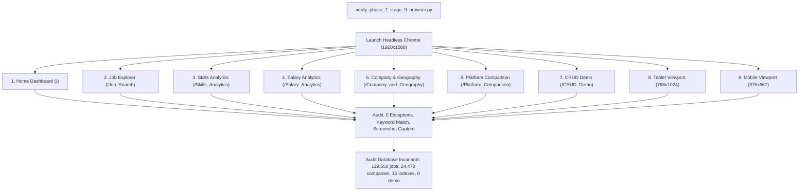

# JobMarketDB — Testing, Verification & Quality Assurance

JobMarketDB maintains a rigorous, multi-tiered testing and quality assurance architecture. The test battery ensures that the analytics engine, database invariants, security guardrails, and editorial UI function with 100% reliability and zero regressions.

---

## 1. Automated Test Suite Inventory (187 Unique Tests)

The test battery comprises **187 automated unit and integration tests** across 12 distinct test suites executed in Python:

```
...........................................................................................................................................................................................
----------------------------------------------------------------------
Ran 187 tests in 99.133s

OK (187/187 Passed - 100% Success Rate)
```

### Complete Test Suite Breakdown:

| Test Suite Module | Scope & Tested Capabilities | Tests | Runtime | Status |
| :--- | :--- | :---: | :---: | :---: |
| [`scripts.test_phase_6_step_4`](../scripts/test_phase_6_step_4.py) | Skills Analytics Aggregation & Taxonomy Pipelines | 28 | ~8.1s | **PASS** |
| [`scripts.test_phase_6_step_7`](../scripts/test_phase_6_step_7.py) | Company & Geographic Intelligence Aggregations | 30 | ~7.8s | **PASS** |
| [`scripts.test_phase_6_step_9`](../scripts/test_phase_6_step_9.py) | CRUD Demonstration Service & Sandbox Primitives | 13 | ~1.1s | **PASS** |
| [`scripts.test_phase_7_stage_1`](../scripts/test_phase_7_stage_1.py) | Shared CSS Design Tokens & UI Component Library | 8 | ~0.5s | **PASS** |
| [`scripts.test_phase_7_stage_2`](../scripts/test_phase_7_stage_2.py) | Job Explorer Query Engine & Multi-Facet Filters | 10 | ~9.8s | **PASS** |
| [`scripts.test_phase_7_stage_3`](../scripts/test_phase_7_stage_3.py) | Executive Overview Dashboard Structure & KPIs | 10 | ~8.6s | **PASS** |
| [`scripts.test_phase_7_stage_4`](../scripts/test_phase_7_stage_4.py) | Skills Analytics Redesign & Taxonomy Disclaimers | 7 | ~9.1s | **PASS** |
| [`scripts.test_phase_7_stage_5`](../scripts/test_phase_7_stage_5.py) | Salary Reconciliation & Outlier Filtering | 7 | ~11.3s | **PASS** |
| [`scripts.test_phase_7_stage_6`](../scripts/test_phase_7_stage_6.py) | Employer Leaderboard & US Choropleth Mapping | 10 | ~11.0s | **PASS** |
| [`scripts.test_phase_7_stage_7`](../scripts/test_phase_7_stage_7.py) | Platform Comparison & 14-Field Completeness Audit | 9 | ~9.7s | **PASS** |
| [`scripts.test_phase_7_stage_8`](../scripts/test_phase_7_stage_8.py) | Database Operations Workspace & Safety Invariants | 37 | ~1.1s | **PASS** |
| [`scripts.test_phase_7_stage_9`](../scripts/test_phase_7_stage_9.py) | Comprehensive Cross-Page System Invariants | 18 | ~13.4s | **PASS** |
| **Total Automated Regression Suite** | **Entire Application & Analytical Engine** | **187** | **99.133s** | **100% PASS** |

---

## 2. Key Testing Domains & Verified Properties

### 2.1. Database Invariant Immutability
- **Canonical Counts**: Validates that `jobs` contains strictly `129,550` documents and `companies` contains strictly `24,472` documents.
- **Index Definitions**: Asserts that exactly 11 indexes exist on `jobs` and 4 on `companies` (15 total production indexes).
- **Sandbox Purity**: Verifies that `demo_postings` is reset to 0 documents after all test runs.

### 2.2. Security & Connection Guardrails
- **Loopback Enforcement**: Verifies that any non-loopback host (remote IP, cloud hostname, MongoDB Atlas `mongodb+srv://`) is rejected with a descriptive `ValueError` before connecting.
- **Replica-Set Discovery Block**: Verifies that `directConnection=True` is enforced to prevent replica-set peer discovery.
- **Credential Masking**: Asserts that MongoDB connection strings containing passwords have credentials masked in log files and error messages.
- **Prohibited Write Operations**: Static AST analysis verifies that `delete_many` and `drop` methods are completely absent from the CRUD interface.

### 2.3. Analytical Precision & Reconciled Benchmarks
- **Salary Integrity**: Asserts LinkedIn Adjusted Mean equals `$95,515.00` and Median equals `$81,375.00` across `36,021` records $\le \$1,000,000$.
- **Indeed Midpoints**: Asserts Indeed Mean Midpoint equals `$116,501.31` and Median equals `$110,000.00` across `5,715` records.
- **Taxonomy Boundaries**: Validates exactly 35 distinct functional skills on LinkedIn and 464 distinct technical skills on Indeed.
- **Shared Employers**: Asserts that cross-platform employer matching identifies exactly 570 shared employers.

### 2.4. UI Resilience & XSS Defense
- **HTML Sanitization**: Verifies that all user input rendered into Streamlit card markup passes through `html.escape()`.
- **Form Encapsulation**: Verifies that CRUD operations are encapsulated within Streamlit forms to prevent premature script reruns.

---

## 3. Automated Browser Verification (Playwright & Chrome)

To verify real-world rendering, responsiveness, and JavaScript execution, the project uses **Google Chrome via Playwright** ([`scripts/verify_phase_7_stage_9_browser.py`](../scripts/verify_phase_7_stage_9_browser.py)):



### Measured Browser Metrics Across All 7 Pages:

| Page Verified | Direct Route | Measured Load Time | Text Length | Exceptions / Tracebacks | Status |
| :--- | :--- | :---: | :---: | :---: | :---: |
| **1. Home Dashboard** | `http://localhost:8501/` | `9.23s` | 8,727 chars | **0** | **PASS** |
| **2. Job Explorer** | `http://localhost:8501/Job_Search` | `4.91s` | 3,342 chars | **0** | **PASS** |
| **3. Skills Analytics** | `http://localhost:8501/Skills_Analytics` | `5.25s` | 3,155 chars | **0** | **PASS** |
| **4. Salary Analytics** | `http://localhost:8501/Salary_Analytics` | `4.86s` | 4,723 chars | **0** | **PASS** |
| **5. Company & Geography** | `http://localhost:8501/Company_and_Geography` | `4.84s` | 6,105 chars | **0** | **PASS** |
| **6. Platform Comparison** | `http://localhost:8501/Platform_Comparison` | `4.80s` | 4,498 chars | **0** | **PASS** |
| **7. CRUD Demo** | `http://localhost:8501/CRUD_Demo` | `36.84s` | 2,304 chars | **0** | **PASS** |

---

## 4. How to Execute Tests & Verification Locally

### 4.1. Run the Complete 187-Test Regression Battery
```bash
python -m unittest scripts.test_phase_6_step_4 scripts.test_phase_6_step_7 scripts.test_phase_6_step_9 scripts.test_phase_7_stage_1 scripts.test_phase_7_stage_2 scripts.test_phase_7_stage_3 scripts.test_phase_7_stage_4 scripts.test_phase_7_stage_5 scripts.test_phase_7_stage_6 scripts.test_phase_7_stage_7 scripts.test_phase_7_stage_8 scripts.test_phase_7_stage_9
```

### 4.2. Run the Focused System Invariant Suite
```bash
python scripts/test_phase_7_stage_9.py
```

### 4.3. Run the Security & Local Connection Enforcement Suite
```bash
python scripts/test_local_mongodb_enforcement.py
```

### 4.4. Run the Full Real-Browser Playwright Suite
*(Requires active Streamlit server running on port 8501)*
```bash
python scripts/verify_phase_7_stage_9_browser.py
```
