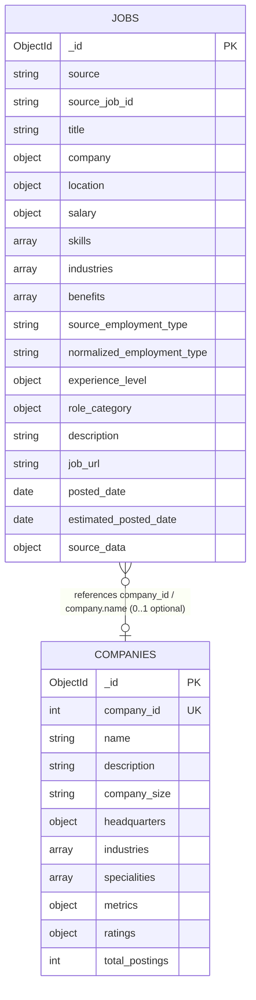

# Phase 2: MongoDB / NoSQL Data Model Design

## 1. Architectural Strategy & Design Principles

### 1.1 The Relational-to-Document Transformation
In a traditional relational system (such as the raw LinkedIn archive), job data is normalized across 11 discrete tables connected by foreign keys (`job_id`, `company_id`, `industry_id`, `skill_abr`). Reconstructing a single job posting for a search results page requires joining up to 7 tables simultaneously (`postings`, `companies`, `job_skills`, `skills_mapping`, `job_industries`, `industries_mapping`, `benefits`).

In MongoDB, we leverage **document embedding**, **multi-key arrays**, and the **Extended Reference Pattern** to optimize for high-frequency read operations while keeping the architecture maintainable, scalable, and easy to explain in an Advanced Database Management Systems (ADBMS) defense.

---

### 1.2 Collection Architecture: Hybrid Two-Collection Design

We recommend a **two-collection architecture**:
1. **`jobs` (Primary Collection):** The central operational collection designed for the full set of source postings from both datasets (129,564 source postings). After Phase 3 validation, 129,550 postings are eligible for MongoDB import because 14 LinkedIn records with null titles were rejected.
2. **`companies` (Supporting Collection):** The master employer collection holding detailed corporate profiles, historical employee counts, specialties, and aggregated hiring metrics.



---

## 2. Data Provenance Framework & Critical Integrity Rules

To ensure strict academic and engineering rigor, all fields in the data model belong to one of three explicit provenance tiers:

| Provenance Tier | Formal Definition | Examples in Proposed Model |
| :--- | :--- | :--- |
| **SOURCE** | Directly present in the original dataset without alteration of meaning or structure. | LinkedIn `title`, `formatted_work_type`, `original_listed_time`, `job_id`; Indeed `Job_Title`, `Queried_Salary`, `Job_Type`, `Date_Since_Posted`. |
| **NORMALIZED** | Converted into a common, standardized representation without claiming it was originally present in exactly that form. | Standardized US State 2-letter codes (`location.state`), title-cased industries, harmonized salary bucket labels (`salary.salary_bucket`). |
| **DERIVED / INFERRED** | Calculated, estimated, or inferred from one or more source fields using heuristic rules or mathematical formulas. | `salary.estimated_midpoint` (midpoint of a salary range), `role_category` (inferred from title for cross-dataset analysis), `estimated_posted_date` (calculated from relative days). |

---

### 2.1 Identifier Disambiguation: `_id` vs `source` vs `source_job_id`
We strictly separate database internal identifiers from source data identifiers:
- **`_id`**: Native MongoDB `ObjectId` generated by the database engine.
- **`source`**: Identifies the dataset origin (`"linkedin"` or `"indeed"`).
- **`source_job_id`**: The authentic identifier from the source platform:
  - **LinkedIn [SOURCE]:** The native integer job identifier from `postings.csv` (`job_id`, stored as string, e.g. `"3757940104"`).
  - **Indeed [DERIVED / EXTRACTED]:** Extracted from the URL query parameter `jk=` in `Link` (e.g. `"6a105f495c36a287"`). Documented explicitly: **Indeed has no native `job_id` column in the CSV**; the identifier is extracted from the URL. We do not invent a fake primary key.

---

### 2.2 Preservation of Source Skills (No False Taxonomical Equivalencies)
LinkedIn and Indeed operate at fundamentally different levels of skill granularity:
- **LinkedIn Skills [SOURCE]:** 35 high-level functional disciplines / domain codes (e.g., `IT` -> Information Technology, `ENG` -> Engineering, `ANLS` -> Analyst, `FIN` -> Finance, `MGMT` -> Management).
- **Indeed Skills [SOURCE]:** Specific technical tools, libraries, and frameworks (e.g., `Python`, `SQL`, `Machine Learning`, `R`, `Tableau`, `AWS`, `Spark`).

**Mandatory Rule:** We do NOT force artificial equivalencies between datasets (such as claiming LinkedIn `"IT"` equals Indeed `"Python"` or LinkedIn `"ANLS"` equals Indeed `"SQL"`).
- The `skills` array preserves **authentic source-level data**.
- Any future unified skill taxonomy is strictly an **application-level derived/analytical field** and is not implemented in Phase 2.

---

### 2.3 Experience Level: Observed vs. Inferred
We distinguish between data observed directly in the source versus values inferred via heuristic rules:
- **OBSERVED [SOURCE]:** Directly present in the source dataset (e.g., LinkedIn's `formatted_experience_level` containing `"Mid-Senior level"`, `"Entry level"`, `"Associate"`).
- **INFERRED [DERIVED]:** Derived from another field (e.g., inferring seniority from an Indeed title containing `"Senior Data Scientist"`).
- To preserve integrity, Indeed postings do NOT pretend to have an original experience level. They record `value: null, status: "NOT_AVAILABLE"`. Inferred values are never converted into authoritative source data.

---

### 2.4 Salary Integrity: Discrete Bands, Continuous Pay & Midpoint Estimates
To prevent distortion of financial data:
- **No Range-to-Exact Conversion:** An Indeed query band such as `"<80000"` or `"100000-119999"` is NEVER converted into a fake exact salary.
- **Indeed Salary Representation:**
  - `salary.salary_bucket` [SOURCE / NORMALIZED]: Preserves the queried salary bracket.
  - `salary.normalized_annual`: **UNAVAILABLE (`null`)**. Indeed does not provide an authoritative continuous annual salary.
  - `salary.estimated_midpoint` [DERIVED]: Mathematical midpoint estimated from the discrete salary band for visualization/analytics.
- **LinkedIn `normalized_annual` [SOURCE]:** Stored directly from LinkedIn's source column `normalized_salary` (an annualized calculation provided by LinkedIn for yearly/hourly pay). When missing, remains `null`.
- **LinkedIn `estimated_midpoint`:** **`null`**. Never populated for LinkedIn postings since continuous stated salary boundaries exist.
- **Missing Salaries:** Missing compensation data is stored strictly as `null`. It is **NEVER converted to 0**.

---

### 2.5 Employment Type: Source vs. Normalized
- **LinkedIn:**
  - `source_employment_type` [SOURCE]: Preserves the exact source value from `formatted_work_type` (`"Full-time"`, `"Contract"`, `"Part-time"`, `"Temporary"`, `"Internship"`, `"Volunteer"`, `"Other"`).
  - `normalized_employment_type` [NORMALIZED]: Standardized application representation.
- **Indeed:**
  - `source_employment_type` [SOURCE]: **`null`**. The Indeed dataset does NOT contain an employment contract type column (such as Full-time or Part-time). The column `Job_Type` in Indeed denotes professional discipline (`data_scientist`, `data_analyst`, `data_engineer`), NOT employment contract type.
  - `normalized_employment_type` [NORMALIZED]: **`null`**. We do **NOT** silently invent an employment type when the source value is missing.

---

### 2.6 Role Category Provenance by Dataset
`role_category` is an application-level field created to enable cross-dataset comparative queries (e.g., comparing Data Scientist postings between platforms). Its provenance is explicitly distinct by dataset:
- **LinkedIn: DERIVED / INFERRED**
  - Derived from the job `title` using role classification rules (e.g., title containing "Data Analyst" -> `role_category.value: "Data Analyst"`, `role_category.status: "DERIVED / INFERRED"`).
- **Indeed: NORMALIZED**
  - Normalized from the source `Job_Type` field (`data_scientist` -> `role_category.value: "Data Scientist"`, `role_category.status: "NORMALIZED"`).

The provenance is not identical between sources: Indeed normalizes an authentic source discipline field, whereas LinkedIn infers the role category heuristically from title text.

---

### 2.7 Posted Date: Source vs. Estimated
- **LinkedIn `posted_date` [SOURCE]:** Directly converted from the native source timestamp `original_listed_time` (epoch milliseconds) into an ISO Date. This represents an authentic publication timestamp.
- **Indeed:**
  - Native publication timestamp is **NOT AVAILABLE** in the source dataset. Indeed only provides `Date_Since_Posted` (a relative float representing days elapsed, e.g. `30.0` or `1.0`).
  - Therefore, `posted_date` is **`null`**.
  - A calculated publication date is stored in a separate, dedicated field named `estimated_posted_date` [DERIVED / ESTIMATED], calculated from `Date_Since_Posted` and a documented reference crawl date. We do not invent an exact native publication timestamp.

---

### 2.8 Remote Work: Tri-State Representation
Remote status is represented as a **tri-state boolean**:
- `true`: Explicitly confirmed remote from source data (e.g., LinkedIn `remote_allowed == 1.0`).
- `false`: Explicitly confirmed non-remote / on-site from source data.
- `null`: Unknown / not available from source data (e.g., Indeed postings lacking a dedicated remote indicator).
- We do **NOT** default unknown Indeed postings to `false`.

---

## 3. Embedding vs. Referencing Design Decisions

| Entity / Dimension | Decision | Architecture Rationale | ADBMS / Academic Justification |
| :--- | :--- | :--- | :--- |
| **Skills** | **Embedded Array** (`["Python", "SQL", ...]`) | Preserves authentic source-level skills without artificial mapping. Multi-key indexes (`db.jobs.createIndex({ skills: 1 })`) support rapid `$in` filtering and `$unwind` aggregations. | Eliminates expensive M:N junction tables (`job_skills`) and mapping lookups. Document size overhead is negligible (< 150 bytes per job). |
| **Industries** | **Embedded Array** (`["IT Services", ...]`) | Jobs belong to 1–3 industry categories. Array embedding enables multi-industry filtering without foreign-key joins. | Resolves `job_industries` and `mappings/industries` joins into a single array lookup. |
| **Benefits** | **Embedded Array** (`["401(k)", "Medical insurance", ...]`) | Specific to LinkedIn postings; maximum 12 distinct types with low cardinalities (2–5 benefits per job). | 1:N relationship with small bounded growth. Perfect fit for document embedding. |
| **Salary** | **Embedded Subdocument** (`salary: { min, max, normalized_annual, salary_bucket, estimated_midpoint }`) | Co-locates original compensation, normalized annual figures (LinkedIn), query brackets (Indeed), and derived midpoints. | Prevents silent data distortion by separating exact stated pay from derived midpoints. |
| **Location** | **Embedded Subdocument** (`location: { raw, city, state, country, is_remote }`) | Supports hierarchical geographic querying with tri-state remote boolean. | Denormalizes geographic attributes for single-step compound query execution. |
| **Company Summary** | **Embedded Snapshot** (`company: { id, name, size, industry }`) | **Extended Reference Pattern**: Search results need company name, size, and industry immediately. | 99% of user searches only need company name and size; avoids executing a `$lookup` for every search card. |
| **Company Full Profile** | **Separate Collection** (`companies`) | Company descriptions are up to 4 KB each, with hundreds of specialties and time-series employee records. Duplicating full descriptions across 123,849 postings would waste hundreds of megabytes of RAM. | **Subset Pattern**: Keeps primary job documents lean (< 2 KB) for high cache-hit ratios while preserving rich corporate profiles for dedicated analytics. |

---

## 4. Representative MongoDB Documents

### 4.1 Primary Collection: `jobs` Document (LinkedIn Source Example)
```json
{
  "_id": { "$oid": "6627a810f1d2e3a4b5c6d701" },
  "source": "linkedin",
  "source_job_id": "3757940104",
  "title": "Senior Data Analyst",
  "description": "We are seeking an experienced Senior Data Analyst to lead our business intelligence initiatives...",
  "company": {
    "company_id": 20300,
    "name": "First Financial Bank",
    "company_size": "5.0",
    "industry": "Banking"
  },
  "location": {
    "raw": "Houston, TX",
    "city": "Houston",
    "state": "TX",
    "country": "United States",
    "zip_code": "77002",
    "is_remote": false
  },
  "salary": {
    "min_salary": 90000.0,
    "max_salary": 120000.0,
    "med_salary": null,
    "pay_period": "YEARLY",
    "currency": "USD",
    "compensation_type": "BASE_SALARY",
    "normalized_annual": 105000.0,
    "salary_bucket": "100000-119999",
    "estimated_midpoint": null
  },
  "skills": [
    "Analyst",
    "Information Technology",
    "Finance"
  ],
  "industries": [
    "Banking",
    "Financial Services"
  ],
  "benefits": [
    "401(k)",
    "Medical insurance",
    "Dental insurance",
    "Paid maternity leave"
  ],
  "source_employment_type": "Full-time",
  "normalized_employment_type": "Full-time",
  "experience_level": {
    "value": "Mid-Senior level",
    "status": "OBSERVED"
  },
  "role_category": {
    "value": "Data Analyst",
    "status": "DERIVED / INFERRED",
    "derived_from": "title"
  },
  "job_url": "https://www.linkedin.com/jobs/view/3757940104",
  "application_url": "https://careers.firstfinancial.com/jobs/3757940104",
  "application_type": "OffsiteApply",
  "posted_date": { "$date": "2024-01-15T14:30:00.000Z" },
  "estimated_posted_date": null,
  "expiry_date": { "$date": "2024-03-15T14:30:00.000Z" },
  "views_count": 342,
  "applies_count": 48,
  "is_sponsored": false,
  "source_data": {
    "linkedin": {
      "fips": 48201.0,
      "posting_domain": "firstfinancial.com",
      "closed_time": null,
      "skills_desc": null
    }
  }
}
```

---

### 4.2 Primary Collection: `jobs` Document (Indeed Source Example)
```json
{
  "_id": { "$oid": "6627a810f1d2e3a4b5c6d702" },
  "source": "indeed",
  "source_job_id": "6a105f495c36a287",
  "title": "Data Scientist",
  "description": "Express Scripts is looking for a Data Scientist to apply advanced predictive modeling and statistical methods...",
  "company": {
    "company_id": null,
    "name": "Express Scripts",
    "company_size": "10,000+",
    "industry": "Health Care"
  },
  "location": {
    "raw": "MO",
    "city": null,
    "state": "MO",
    "country": "United States",
    "zip_code": null,
    "is_remote": null
  },
  "salary": {
    "min_salary": null,
    "max_salary": null,
    "med_salary": null,
    "pay_period": null,
    "currency": "USD",
    "compensation_type": "QUERY_BUCKET",
    "normalized_annual": null,
    "salary_bucket": "100000-119999",
    "estimated_midpoint": 110000.0
  },
  "skills": [
    "Python",
    "SQL",
    "Machine Learning",
    "R",
    "SAS",
    "Data Analysis"
  ],
  "industries": [
    "Health Care"
  ],
  "benefits": [],
  "source_employment_type": null,
  "normalized_employment_type": null,
  "experience_level": {
    "value": null,
    "status": "NOT_AVAILABLE"
  },
  "role_category": {
    "value": "Data Scientist",
    "status": "NORMALIZED",
    "derived_from": "Job_Type (data_scientist)"
  },
  "job_url": "https://www.indeed.com/rc/clk?jk=6a105f495c36a287",
  "application_url": null,
  "application_type": "IndeedApply",
  "posted_date": null,
  "estimated_posted_date": { "$date": "2024-03-01T00:00:00.000Z" },
  "expiry_date": null,
  "views_count": null,
  "applies_count": null,
  "is_sponsored": false,
  "source_data": {
    "indeed": {
      "row_index": 0,
      "source_job_id_extracted_from_url": true,
      "date_since_posted_days": 30.0,
      "company_revenue": "More than $10B (USD)",
      "company_employees_category": "10,000+",
      "company_reviews_count": 3412.0,
      "company_star_rating": 3.7,
      "skill_count": 6,
      "tool_indicators": {
        "python": 1,
        "sql": 1,
        "machine_learning": 1,
        "r": 1,
        "hadoop": 0,
        "tableau": 0,
        "sas": 1,
        "spark": 0,
        "java": 0,
        "others": 0
      }
    }
  }
}
```

---

### 4.3 Supporting Collection: `companies` Document Example
```json
{
  "_id": { "$oid": "6627a810f1d2e3a4b5c6d801" },
  "company_id": 20300,
  "name": "First Financial Bank",
  "description": "First Financial Bank is a regional banking organization committed to community development...",
  "company_size": "5.0",
  "headquarters": {
    "city": "Cincinnati",
    "state": "OH",
    "country": "US",
    "zip_code": "45202",
    "address": "255 E Fifth Street"
  },
  "url": "https://www.linkedin.com/company/first-financial-bank",
  "industries": [
    "Banking",
    "Financial Services"
  ],
  "specialities": [
    "Commercial Banking",
    "Retail Banking",
    "Mortgage",
    "Wealth Management"
  ],
  "metrics": {
    "latest_employee_count": 1053,
    "latest_follower_count": 6554,
    "last_recorded_at": { "$date": "2024-04-05T12:00:00.000Z" }
  },
  "ratings": {
    "stars": null,
    "reviews_count": null
  },
  "total_active_postings": 14
}
```

---

## 5. Query-Driven Schema Design & Index Planning

| Query / Use Case | Query Implementation in MongoDB | Supporting Document Fields | Recommended Index |
| :--- | :--- | :--- | :--- |
| **1. Job Search by Title** | `db.jobs.find({ $text: { $search: "Data Scientist" } })` or regex filter | `title`, `description` | Text index: `{ title: "text", description: "text" }` |
| **2. Location Filtering** | `db.jobs.find({ "location.state": "TX", "location.is_remote": true })` | `location.state`, `location.is_remote` | Compound: `{ "location.state": 1, "location.is_remote": 1 }` |
| **3. Salary Range & Bucket** | `db.jobs.find({ "salary.salary_bucket": "100000-119999" })` or `normalized_annual >= 90000` | `salary.salary_bucket`, `salary.normalized_annual` | Single / Compound: `{ "salary.salary_bucket": 1, "salary.normalized_annual": 1 }` |
| **4. Skill Demand Filtering** | `db.jobs.find({ skills: { $all: ["Python", "SQL"] } })` | `skills` (Array) | Multi-key index: `{ skills: 1 }` |
| **5. Company Filtering** | `db.jobs.find({ "company.name": "Express Scripts" })` | `company.name`, `company.company_id` | Index: `{ "company.name": 1 }` |
| **6. Experience Level** | `db.jobs.find({ "experience_level.value": "Mid-Senior level" })` | `experience_level.value` | Index: `{ "experience_level.value": 1 }` |
| **7. Source Filtering** | `db.jobs.find({ source: "linkedin" })` | `source` | Index: `{ source: 1 }` |
| **8. Top Demanded Skills** | Aggregation: `$unwind: "$skills"` -> `$group: { _id: "$skills", count: { $sum: 1 } }` -> `$sort: { count: -1 }` | `skills` (Array) | Multi-key index: `{ skills: 1 }` |
| **9. Top Hiring Companies** | Aggregation: `$group: { _id: "$company.name", postings: { $sum: 1 } }` -> `$sort: { postings: -1 }` | `company.name` | Index: `{ "company.name": 1 }` |
| **10. Top Job Locations** | Aggregation: `$group: { _id: "$location.state", count: { $sum: 1 } }` -> `$sort: { count: -1 }` | `location.state` | Index: `{ "location.state": 1 }` |
| **11. Salary Distributions** | Aggregation: `$match: { "salary.salary_bucket": { $ne: null } }` -> `$group: { _id: "$salary.salary_bucket", count: { $sum: 1 } }` | `salary.salary_bucket`, `salary.normalized_annual`, `salary.estimated_midpoint` | Compound: `{ "salary.salary_bucket": 1, "salary.normalized_annual": 1 }` |
| **12. LinkedIn vs. Indeed Comparison** | Aggregation: `$group: { _id: "$source", count: { $sum: 1 } }` | `source`, `salary` | Compound: `{ source: 1, "salary.salary_bucket": 1 }` |
