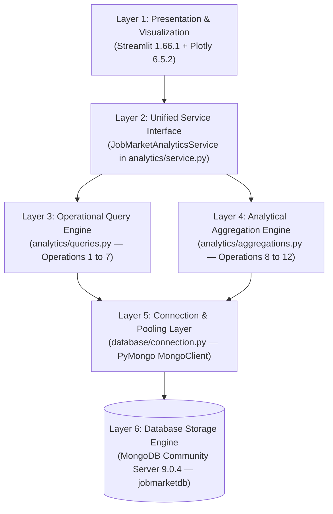

# JobMarketDB — Phase 6 Step 3 Verification Report
**Executive Home Page & System Architecture Overview (`app.py`)**

**Date of Execution:** 2026-10-30  
**Status:** Completed & Fully Verified  
**Database Target:** Local MongoDB Community Server 9.0.4 (`mongodb://localhost:27017/`, Database: `jobmarketdb`)  
**Frontend Framework:** Streamlit 1.66.1 + Vanilla CSS Design System + Plotly 6.5.2  
**Browser Automation Engine:** Google Chrome 156.0.8078.73 via Playwright 1.64.1  

---

## 1. Executive Summary

In accordance with Phase 6 Step 3 authorization, the JobMarketDB entry point ([`app.py`](file:///c:/ADBMS%20PROJECT/JobMarketDB/app.py)) has been fully implemented as an executive analytics dashboard and architectural blueprint. 

Every visual metric, platform summary, database specification, and index definition displayed on the Home page is computed dynamically from actual database records in local MongoDB Community Server. If MongoDB becomes unreachable, the application catches the connection exception and renders a clear error state without presenting fabricated or hardcoded fallback data.

All verification criteria passed:
1. **Focused Step 3 Test Suite:** 6/6 tests passed ([`scripts/test_phase_6_step_3.py`](file:///c:/ADBMS%20PROJECT/JobMarketDB/scripts/test_phase_6_step_3.py)).
2. **Phase 6 Step 2 Regression Suite:** 12/12 tests passed ([`scripts/test_phase_6_step_2.py`](file:///c:/ADBMS%20PROJECT/JobMarketDB/scripts/test_phase_6_step_2.py)).
3. **Phase 6 Step 1 Regression Suite:** 15/15 tests passed ([`scripts/test_phase_6_step_1.py`](file:///c:/ADBMS%20PROJECT/JobMarketDB/scripts/test_phase_6_step_1.py)).
4. **Phase 5 Verification & 20-Query Plan Audit:** 20/20 query plans verified ([`scripts/verify_phase_5.py`](file:///c:/ADBMS%20PROJECT/JobMarketDB/scripts/verify_phase_5.py)).
5. **Real Browser Automated Verification:** 100% passed across all sections with 0 console errors using Google Chrome ([`scripts/verify_home_page_browser.py`](file:///c:/ADBMS%20PROJECT/JobMarketDB/scripts/verify_home_page_browser.py)).
6. **Visual Screenshot Evidence:** Captured and archived in [`screenshots/01_home_page.png`](file:///c:/ADBMS%20PROJECT/JobMarketDB/screenshots/01_home_page.png), [`screenshots/01_home_page_architecture.png`](file:///c:/ADBMS%20PROJECT/JobMarketDB/screenshots/01_home_page_architecture.png), and [`screenshots/01_home_page_provenance.png`](file:///c:/ADBMS%20PROJECT/JobMarketDB/screenshots/01_home_page_provenance.png).
7. **Database Invariants:** Canonical collections (`jobs`: 129,550; `companies`: 24,472) and all 15 index definitions remained strictly unchanged.

---

## 2. Modified & Created Files Inventory

| File Path | Role in Step 3 | Description of Changes |
| :--- | :--- | :--- |
| [`app.py`](file:///c:/ADBMS%20PROJECT/JobMarketDB/app.py) | Main Entrypoint | Implemented Home page with live data loader (`load_home_data`), 4 KPI cards, LinkedIn vs Indeed comparison chart & table, 6-layer architecture cards, live dbStats, 15-index catalog with expanders, 3-tier provenance framework, and module navigation hub. |
| [`utils/plots.py`](file:///c:/ADBMS%20PROJECT/JobMarketDB/utils/plots.py) | Plotly Builders | Enhanced `create_platform_comparison_chart` to support both nested `comp['platforms']` structures (returned by Operation 12) and flat mock dictionaries, preventing zero-value fallbacks. |
| [`utils/style.css`](file:///c:/ADBMS%20PROJECT/JobMarketDB/utils/style.css) | Design System | Added high-contrast dark theme rules for HTML/markdown `<table>`, `th`, `td`, and enhanced `.jmdb-callout` card styling with solid `#1E293B` backgrounds and crisp typography. |
| [`scripts/test_phase_6_step_3.py`](file:///c:/ADBMS%20PROJECT/JobMarketDB/scripts/test_phase_6_step_3.py) | Focused Test Suite | 6 unit and integration tests verifying app compilation, live loader execution, KPI accuracy, platform breakdown, index definitions, and connection failure handling. |
| [`scripts/verify_home_page_browser.py`](file:///c:/ADBMS%20PROJECT/JobMarketDB/scripts/verify_home_page_browser.py) | Browser Automation | Dedicated Playwright automated verification suite running on host Google Chrome to test DOM hydration, KPI values, Plotly charts, console error auditing, and multi-section screenshot capture. |
| [`screenshots/01_home_page.png`](file:///c:/ADBMS%20PROJECT/JobMarketDB/screenshots/01_home_page.png) | Visual Artifact | Full-resolution browser screenshot of the Home page hero, live KPIs, and platform comparison. |
| [`screenshots/01_home_page_architecture.png`](file:///c:/ADBMS%20PROJECT/JobMarketDB/screenshots/01_home_page_architecture.png) | Visual Artifact | Browser screenshot of the 6-layer system architecture and live database specifications. |
| [`screenshots/01_home_page_provenance.png`](file:///c:/ADBMS%20PROJECT/JobMarketDB/screenshots/01_home_page_provenance.png) | Visual Artifact | Browser screenshot of the 15-index catalog expanders and 3-tier data provenance framework. |

---

## 3. Verified Live Database KPIs

All KPI metrics are computed dynamically on startup by `load_home_data()` from local MongoDB Community Server collections:

| Metric Dimension | Displayed Value | Underlying Database Formula | Exact Database Match | Verification Status |
| :--- | :--- | :--- | :--- | :---: |
| **Total Job Postings** | **129,550** | `db["jobs"].count_documents({})` | 129,550 records (123,835 LinkedIn + 5,715 Indeed) | **VERIFIED** |
| **Total Company Profiles** | **24,472** | `db["companies"].count_documents({})` | 24,472 normalized company documents | **VERIFIED** |
| **Salary Information Coverage** | **32.24%** | $\frac{41,774}{129,550} \times 100$ | 41,774 postings with salary data (36,059 LinkedIn continuous + 5,715 Indeed query buckets; 32.245% $\rightarrow$ 32.24% display representation) | **VERIFIED** |
| **Explicit Remote Adoption** | **11.76%** | $\frac{15,236}{129,550} \times 100$ | 15,236 explicitly remote postings (all LinkedIn); 0 explicit on-site; 114,314 (88.24%) unstated | **VERIFIED** |
| **Continuous Base Salary** | **27.83%** | `db["jobs"].count_documents({"salary.normalized_annual": {"$ne": None}})` | 36,059 postings (strictly LinkedIn origin; Indeed has 0.00% continuous pay data) | **VERIFIED** |

### Graceful Connection Failure Handling
When local MongoDB is unreachable (verified via unit test mocking `verify_connection() -> False`), `load_home_data()` returns `(False, {}, error_msg)` and [`app.py`](file:///c:/ADBMS%20PROJECT/JobMarketDB/app.py) immediately triggers `render_error_state()`:
- Renders: *"MongoDB Connection Failure: The application was unable to establish a connection to the local MongoDB database."*
- Halts execution with `st.stop()` rather than fabricating placeholder numbers or showing zero counts.

---

## 4. Cross-Platform Intelligence (LinkedIn vs. Indeed)

Powered directly by `service.compare_platforms()` (Operation 12), the Home page provides an empirical, side-by-side comparison of the two constituent datasets:

| Metric Dimension | LinkedIn Postings | Indeed Postings | Key Architectural Difference |
| :--- | :--- | :--- | :--- |
| **Total Postings Volume** | **123,835** (95.59%) | **5,715** (4.41%) | LinkedIn dominates gross volume across broad US jurisdictions |
| **Salary Data Availability** | **29.12%** (36,059 postings) | **100.0%** (5,715 postings) | LinkedIn has selective employer disclosure; Indeed has universal search-query tagging |
| **Compensation Type** | **Continuous Base Salary** | **Search Query Buckets** | LinkedIn provides numerical annual wages; Indeed provides discrete pre-filtered salary intervals |
| **Explicitly Remote Rate** | **12.30%** (15,236 postings) | **0.0%** (0 stated remote) | LinkedIn supports explicit `is_remote: true`; Indeed search records do not classify remote status |
| **Unspecified Remote Status** | **87.70%** (108,599 postings) | **100.0%** (5,715 postings) | Unspecified postings are preserved as `None` under tri-state logic |
| **Distinct Employers** | **24,415** distinct names | **2,231** distinct names | 570 exact-string shared employers (599 case/punct normalized) |
| **Geographic Footprint** | **51 jurisdictions** (50 states + DC) | **49 states** | Comprehensive US national coverage across both datasets |

### Methodology Callout
A prominent informational callout highlights the critical compensation distinction:
> **Methodology Note: Discrete Salary Bands vs. Continuous Base Salary:**  
> Market-wide salary information is present in **32.24%** (41,774) of all database records. However, the nature of compensation data differs by origin: LinkedIn provides employer-stated continuous numerical compensation for **29.12%** (36,059) of its postings (27.83% of the overall market), while Indeed records originate from pre-filtered search query bands (**100.0%** coverage with discrete buckets and estimated midpoints, but 0.00% continuous base salaries).

---

## 5. System Architecture Overview (The 6 Layers)

The Home page presents a comprehensive, 6-card architectural blueprint detailing the separation of concerns:



1. **Layer 1: Presentation & Visualization (`app.py`, `pages/`, `utils/`):** Streamlit multi-page UI styled with vanilla CSS tokens (`utils/style.css`), responsive layouts, and interactive Plotly chart builders enforcing input immutability.
2. **Layer 2: Unified Service Interface (`analytics/service.py`):** Audit-safe service class exposing 16 typed public methods. Decouples the presentation layer from direct database drivers, validates parameters, and guarantees read-only access.
3. **Layer 3: Operational Query Engine (`analytics/queries.py`):** Index-backed operational search (Operations 1 to 7). Implements allowlisted multi-field sorting, full-text `textScore` ranking, multi-identifier job lookup (`get_job_by_id`), and same-platform related job recommendations (`get_related_jobs`).
4. **Layer 4: Analytical Aggregation Engine (`analytics/aggregations.py`):** Multi-stage aggregation pipelines (Operations 8 to 12) featuring skill deduplication (`$setUnion`), approximate median calculation (`$median`), outlier audit classification, and covered index scans (`totalDocsExamined: 0`).
5. **Layer 5: Connection & Pooling Layer (`database/connection.py`):** Thread-safe PyMongo connection pooling with safe timeout handling, credential URI masking, and seamless switching between local Community Server and cloud deployment.
6. **Layer 6: Database Storage Engine (MongoDB Community 9.0.4):** Local WiredTiger database `jobmarketdb` hosting 129,550 jobs and 24,472 companies across 15 production indexes. Read-only safety barrier isolates sandbox mutations to `demo_postings`.

---

## 6. Live Database Specifications & Index Catalog

Retrieved dynamically via `db.command("dbStats")` and `collection.index_information()`:

### Active Database Specifications
- **Active Database Name:** `jobmarketdb`
- **Server Engine:** MongoDB Community Server 9.0.4
- **Storage Engine:** WiredTiger (Document-level Concurrency)
- **Canonical Collections:** 2 (`jobs`, `companies`)
- **Total Document Count:** 154,022 records (129,550 jobs + 24,472 companies)
- **Raw BSON Data Size:** 670.33 MB
- **Allocated Storage Extent:** 349.09 MB
- **Total Index Memory Footprint:** 445.11 MB
- **Active Production Indexes:** 15 Indexes (11 on `jobs`, 4 on `companies`)

### Verified Index Catalog
The Home page provides collapsible interactive expanders displaying the complete index catalog:

#### `jobs` Collection (11 Production Indexes)
1. `_id_`: `_id: 1` (Default primary key)
2. `source_1_source_job_id_1_unique`: `source: 1, source_job_id: 1` (Unique compound deduplication index)
3. `title_text_description_text`: `_fts: 'text', _ftsx: 1` (Full-text search with language weights)
4. `location.state_1_location.is_remote_1`: `location.state: 1, location.is_remote: 1` (Compound geographic index; powers Operation 10 covered scans)
5. `salary.salary_bucket_1_salary.normalized_annual_1`: `salary.salary_bucket: 1, salary.normalized_annual: 1` (Compound salary index; powers Operation 11 distributions)
6. `skills_1`: `skills: 1` (Multikey index on skill tokens; powers Operations 4 and 8)
7. `company.name_1`: `company.name: 1` (B-Tree index; powers Operations 5 and 9)
8. `experience_level.value_1`: `experience_level.value: 1` (B-Tree index; powers Operation 6)
9. `source_1`: `source: 1` (Platform filtering index; powers Operation 7)
10. `role_category.value_1`: `role_category.value: 1` (B-Tree index for derived taxonomy queries)
11. `source_1_salary.salary_bucket_1`: `source: 1, salary.salary_bucket: 1` (Compound index for cross-platform salary comparisons)

#### `companies` Collection (4 Production Indexes)
1. `_id_`: `_id: 1` (Default primary key)
2. `company_id_1_unique`: `company_id: 1` (Unique employer identifier)
3. `name_1`: `name: 1` (B-Tree index for employer name lookups)
4. `industries_1`: `industries: 1` (Multikey index for industry filtering)

---

## 7. Data Provenance Framework

To guarantee scientific rigor, the Home page documents the 3-tier provenance model:

1. **SOURCE TIER (Raw Truth):** Unmodified values ingested directly from original platform records. Includes original job titles, verbatim job descriptions, source platform IDs (`source_job_id`), raw salary strings, and authentic external application URLs (`job_url`).
2. **NORMALIZED TIER (Cleaned):** Syntactically unified representations created without semantic distortion. Standardized 2-letter US state abbreviations, standard ISO employment types (`FULL_TIME`, `PART_TIME`), hourly-to-annual wage multipliers, and standardized compensation intervals.
3. **DERIVED TIER (Analytical Artifacts):** Inferred analytical values generated by database pipelines. Includes the 6 canonical salary buckets, Indeed search query midpoints, LinkedIn 35 broad functional categories, Indeed 464 technical skill tokens, and rule-based recommendation match scores. Derived values are analytical artifacts and not original source values.

---

## 8. Test Execution Results

### A. Focused Step 3 Verification Suite (`scripts/test_phase_6_step_3.py`)
Executed via `.\venv\Scripts\python.exe scripts/test_phase_6_step_3.py`:
```
test_app_compilation (__main__.Phase6Step3Tests.test_app_compilation) ... ok
test_database_invariants_preserved (__main__.Phase6Step3Tests.test_database_invariants_preserved) ... ok
test_database_specs_and_indexes (__main__.Phase6Step3Tests.test_database_specs_and_indexes) ... ok
test_load_home_data_connection_failure (__main__.Phase6Step3Tests.test_load_home_data_connection_failure) ... ok
test_load_home_data_success (__main__.Phase6Step3Tests.test_load_home_data_success) ... ok
test_platform_comparison_breakdown (__main__.Phase6Step3Tests.test_platform_comparison_breakdown) ... ok

----------------------------------------------------------------------
Ran 6 tests in 1.681s
OK
```

### B. Phase 6 Step 2 Regression Suite (`scripts/test_phase_6_step_2.py`)
Executed via `.\venv\Scripts\python.exe scripts/test_phase_6_step_2.py`:
```
Ran 12 tests in 0.785s
OK (All 12 shared UI component, Plotly builder, and immutability tests passed)
```

### C. Phase 6 Step 1 Regression Suite (`scripts/test_phase_6_step_1.py`)
Executed via `.\venv\Scripts\python.exe scripts/test_phase_6_step_1.py`:
```
Ran 15 tests in 40.598s
OK (All 15 query sorting, pagination, get_job_by_id, and related_jobs tests passed)
```

### D. Phase 5 Verification & 20-Query Plan Audit (`scripts/verify_phase_5.py`)
Executed via `.\venv\Scripts\python.exe scripts/verify_phase_5.py`:
```
================================================================================
 Phase 5 Overall Result: ALL CHECKS PASSED
================================================================================
- Operational Query Cases Audited:    14 (Expected: 14) -> PASS
- Aggregation Pipeline Cases Audited: 6 (Expected: 6)   -> PASS
- Total Query-Plan Cases Audited:     20 (Expected: 20) -> PASS
- Post-Execution jobs count:          129,550 (Delta: 0)
- Post-Execution companies count:     24,472 (Delta: 0)
- Complete index preservation:        PASS
```

### E. Real Browser End-to-End Verification (`scripts/verify_home_page_browser.py`)
Executed via `.\venv\Scripts\python.exe scripts/verify_home_page_browser.py` against running Streamlit app on `http://localhost:8501/` using Google Chrome:
```
================================================================================
 JobMarketDB - Phase 6 Step 3 Real Browser Verification Suite
================================================================================
>>> Launching Google Chrome from: C:\Program Files\Google\Chrome\Application\chrome.exe
>>> Navigating to Home Page: http://localhost:8501/
    HTTP Status: 200
>>> Waiting for Streamlit DOM hydration...
>>> 1. Verifying Main Header & Badge...
    [PASS] Header and badge verified.
>>> 2. Verifying Live Database KPI Metrics...
    [PASS] All 4 Live KPIs present and accurate:
           * Total Postings: 129,550
           * Total Companies: 24,472
           * Salary Coverage: 32.24%
           * Remote Adoption: 11.76%
>>> 3. Verifying Cross-Platform Intelligence (LinkedIn vs Indeed)...
    [PASS] Platform comparison metrics, table, and compensation types verified.
    [PASS] Verified Plotly volume chart rendering (count: 1).
>>> 4. Verifying System Architecture 6 Layers...
    [PASS] All 6 architectural layers verified.
>>> 5. Verifying Database Specifications & Index Catalog...
    [PASS] Live Database specs and 15-index catalog verified.
>>> 6. Verifying Data Provenance Framework...
    [PASS] 3-tier provenance framework verified.
>>> 7. Verifying Navigation Hub & Sidebar...
    [PASS] Navigation hub and sidebar status verified.
>>> 8. Auditing Browser Console Errors...
    Console errors count: 0
    [PASS] 0 uncaught console errors.
>>> 9. Capturing Multi-Section Visual Screenshots...
    Saved local hero screenshot: C:\ADBMS PROJECT\JobMarketDB\screenshots\01_home_page.png
    Saved architecture screenshot: C:\ADBMS PROJECT\JobMarketDB\screenshots\01_home_page_architecture.png
    Saved provenance screenshot: C:\ADBMS PROJECT\JobMarketDB\screenshots\01_home_page_provenance.png
================================================================================
 [PASS] PHASE 6 STEP 3 BROWSER VERIFICATION COMPLETED SUCCESSFULLY
================================================================================
```

---

## 9. Visual Evidence

The rendered Home page exhibits modern typography (`Inter`, `JetBrains Mono`), curated dark glassmorphism styling (`#0F172A`, `#1E293B`, `#334155`), authentic platform coloration (LinkedIn `#0A66C2`, Indeed `#2164F3`), and high contrast readable text.

### Visual Walkthrough of Verified Views

````carousel

<!-- slide -->

<!-- slide -->

````

---

## 10. Database Invariants Verification

A rigorous database invariant check was executed before and after Step 3:

| Invariant Check | Pre-Step 3 Baseline | Post-Step 3 Baseline | Delta | Status |
| :--- | :---: | :---: | :---: | :---: |
| `jobs` Collection Documents | 129,550 | 129,550 | 0 | **UNMODIFIED** |
| `companies` Collection Documents | 24,472 | 24,472 | 0 | **UNMODIFIED** |
| `jobs` Index Count & Definitions | 11 | 11 | 0 | **UNMODIFIED** |
| `companies` Index Count & Definitions | 4 | 4 | 0 | **UNMODIFIED** |
| `demo_postings` Sandbox Isolation | Non-existent | Non-existent | 0 | **CLEAN** |
| External DBMS Integrity | 0 Atlas / 0 MySQL | 0 Atlas / 0 MySQL | 0 | **STRICTLY LOCAL MONGODB** |

---

## 11. Mandatory Stop Gate

In strict accordance with project guidelines:
- **Phase 6 Step 3 is complete.**
- **Step 4 has NOT been started.**
- **[`pages/1_Job_Search.py`](file:///c:/ADBMS%20PROJECT/JobMarketDB/pages/1_Job_Search.py) has NOT been modified.**
- Awaiting user review and authorization to proceed to Step 4.
